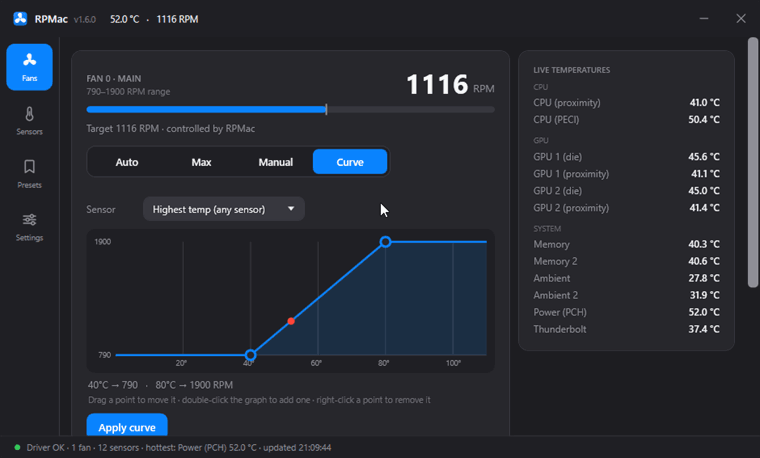
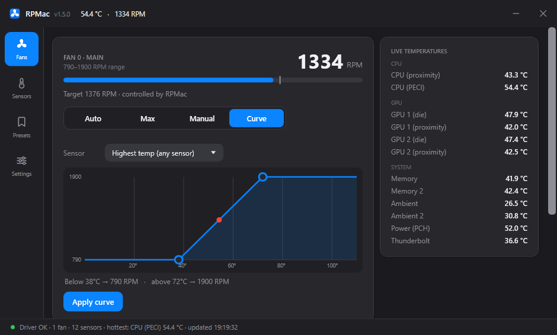
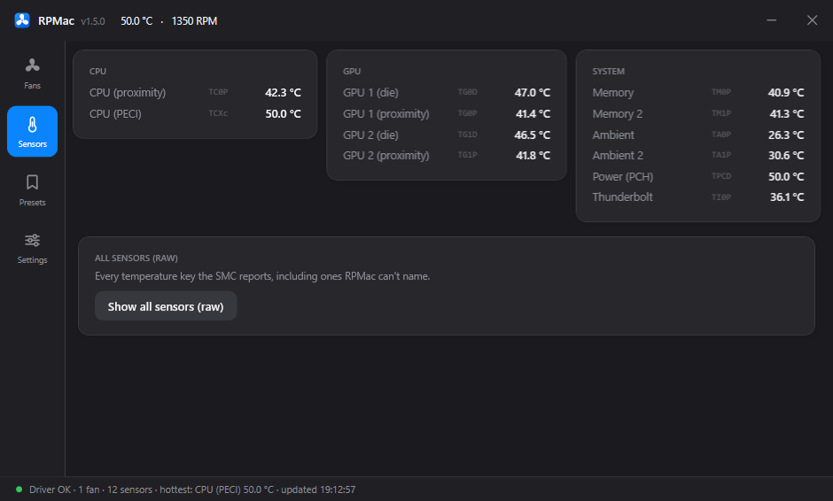
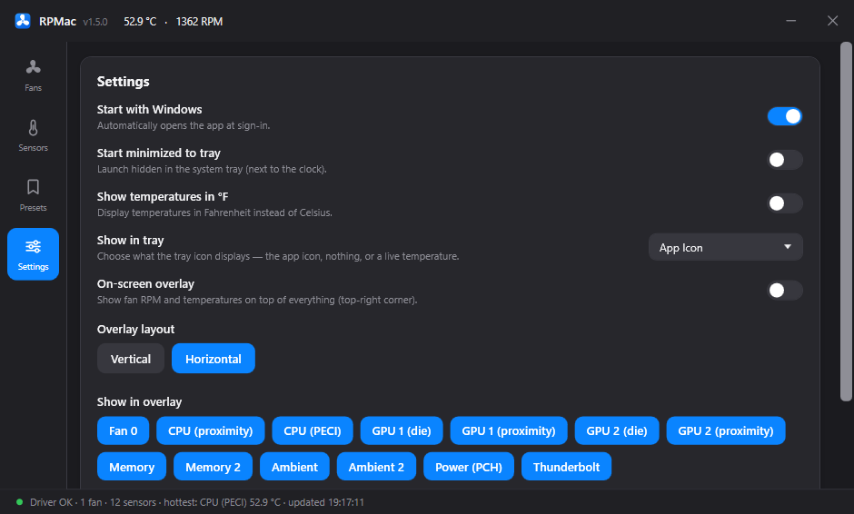
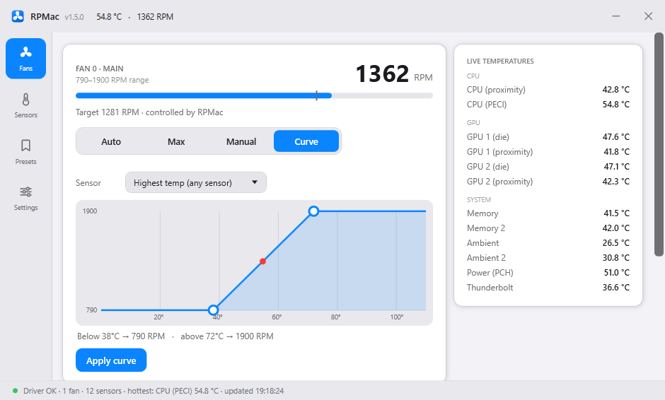
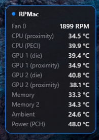
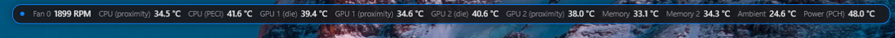

# RPMac

**The other app capable of controlling fans on Intel Macs in Windows — for free.**

RPMac is a free and open-source fan-control utility for **Intel-based Macs running Windows via Boot Camp**. It talks directly to the Mac's **SMC (System Management Controller)** to monitor fan speeds and temperatures, and lets you set each fan to **Automatic**, **Maximum**, or a **custom RPM**. On T2 Macs, it talks to the slightly different SMC interface that the T2 chip exposes, controlling the fans like it would on any non-T2 Mac.

Designed as a lightweight, modern alternative to paid tools, RPMac includes **hardware safety checks**: it stays read-only on non-Apple hardware and never disables the SMC's built-in thermal protection.

## Screenshots

<p align="center">
  
</p>
<p align="center">
  <sub>Adding a point turns a plain ramp into <b>"stay quiet until 58°, then ramp hard"</b> — double-click to add, drag to shape, right-click to remove. The red dot shows where the fan is running on the curve right now.</sub>
</p>

<table>
  <tr>
    <td align="center" width="50%">
      <br>
      <sub><b>Fans</b><br>Curve editor, 5-minute history and live temperatures</sub>
    </td>
    <td align="center" width="50%">
      <br>
      <sub><b>Sensors</b><br>Grouped by CPU / GPU / system, with the raw SMC key</sub>
    </td>
  </tr>
  <tr>
    <td align="center" width="50%">
      <br>
      <sub><b>Settings</b><br>Start with Windows · °C/°F · tray mode · overlay · themes</sub>
    </td>
    <td align="center" width="50%">
      <br>
      <sub><b>Four themes</b><br>Dark · Light · Nature · Japan, applied instantly</sub>
    </td>
  </tr>
</table>


**On-screen overlay** (FRAPS-style, always on top — works over games in borderless/windowed mode):

<table>
  <tr>
    <td align="center">
      <br>
      <sub><b>Vertical</b></sub>
    </td>
    <td align="center">
      <br>
      <sub><b>Horizontal (compact)</b></sub>
    </td>
  </tr>
</table>

## Features
- Real-time fan RPM and temperature monitoring
- Per-fan control: **Auto / Max / Manual RPM / temperature curve**
- **Graphical curve editor** — as many points as you want (double-click to add, right-click to remove, drag to shape), with a live dot showing exactly where the fan is running on the curve right now
- **Curve on the hottest sensor** — instead of picking one sensor, let the fan follow whichever is hottest, so it ramps up when *either* the CPU or the GPU heats up
- **Smooth fan changes** — ignores tiny temperature wobbles so a curve doesn't make the fan audibly hunt up and down
- **Emergency cooling** — if any sensor reaches a temperature you set, every fan goes to maximum until it cools down
- **Emergency shutdown** — for a machine nobody is watching: if the heat holds even with the fans at maximum, or a fan that is being told to spin stays stopped, RPMac tells Windows to shut down cleanly instead of waiting for the CPU to cut power on its own. Off by default, and it never acts on a single reading
- **Copy a curve to all fans**, rescaled to each fan's own RPM range
- **5-minute history graph** of temperature and fan speed, plus optional **CSV recording** of every reading
- **Presets** — save your fan setup as named profiles (e.g. Silent, Gaming) and switch with one click, from the app or the tray icon
- All sensors grouped by CPU / GPU / system, with their raw SMC keys (plus a full raw view)
- **Name your own sensors** — if your Mac exposes a sensor RPMac doesn't know, give it a name and it becomes usable everywhere: curves, "Highest temp", overlay, tray and CSV
- On-screen overlay (FRAPS-style): always-on-top, top-right corner, vertical or horizontal, with selectable fans/sensors
- Live temperature on the tray icon (highest sensor or a specific one) — or just the app icon, or nothing
- Themes: Dark / Light / Nature / Japan
- **Interface languages**: English and Italian — pick one in Settings → Language
- Temperatures in °C or °F
- Start with Windows + start minimized to tray
- Remembers your settings and re-applies them (including after sleep/resume)
- Command-line tool (`smccore.exe`) for scripting fan control
- Safety first — read-only unless it confirms a genuine Apple Mac with a valid SMC; clamps RPM to the SMC's own min/max
- Lightweight native UI — portable, no runtime to install (T2 Macs only need the free PawnIO driver)
- Free and open source (GPL-2.0)

## Install
Two ways, same app. The installer is the easiest; the zip needs no setup and runs from its own folder.

### Installer (easiest)
1. Go to the [**Releases**](https://github.com/golirt1/RPMAC/releases/latest) page and download `RPMac-v1.11.0-setup.exe` (under **Assets**).
2. **Double-click it** and follow the steps. It installs RPMac, sets it to start with Windows (you can untick that), adds `smccore.exe` to the PATH, and **on T2 Macs (2018-2020) it also installs PawnIO**, the driver RPMac needs there.
3. RPMac opens at the end. Set each fan to **Auto / Max / a custom RPM**. Temperatures update live.

To uninstall, use *Settings → Apps → RPMac*. That also removes the small InpOut driver RPMac uses on Macs without a T2. PawnIO stays installed because other apps can use it too; remove it from *Settings → Apps* if you don't need it.

### Portable (zip)
1. From the same [**Releases**](https://github.com/golirt1/RPMAC/releases/latest) page, download `RPMac-v1.11.0-windows.zip`.
2. **Unzip it** to any folder you like (e.g. your Desktop). Keep every file from the zip (`RPMac.exe`, `RPMac.exe.config`, `smccore.exe`, `inpout32.dll`, `AppleT2Smc.bin`, `PawnIO_setup.exe`) **together in the same folder**.
3. **Right-click `RPMac.exe` → "Run as administrator"** (administrator rights are required to access the Mac's hardware/SMC).
4. **T2 Macs only (2018-2020):** RPMac needs the free PawnIO driver and offers to install it for you with one click — see [T2 Macs](#t2-macs-2018-2020) below.
5. Set each fan to **Auto / Max / a custom RPM**. Temperatures update live.

### T2 Macs (2018-2020)
On T2 Macs the T2 chip hides the SMC from the usual I/O ports, so RPMac reaches it through its own small kernel module for [PawnIO](https://pawnio.eu). That module (`AppleT2Smc.bin`) is signed and published in [PawnIO.Modules 0.2.12](https://github.com/namazso/PawnIO.Modules/releases/tag/0.2.12), so the regular PawnIO is all you need:

- **With the installer**, there is nothing to do: on a T2 Mac it installs PawnIO for you.
- **With the zip**, run RPMac as administrator. If PawnIO isn't installed yet, the read-only card says so and shows an **Install PawnIO** button: it runs PawnIO's official installer (`PawnIO_setup.exe`, included in the zip and signed by its author), and RPMac connects to the T2 by itself as soon as it finishes.
- Or install PawnIO yourself from [pawnio.eu](https://pawnio.eu) — either way, fans and temperatures then show up just like on any other Mac.

No unrestricted edition, no test-signing mode and no specific PawnIO version are needed any more. If you set those up for the earlier test builds, the signed module loads there too; to go back to a normal setup, uninstall that PawnIO, install the regular one, run `bcdedit /set testsigning off` in an administrator terminal and reboot.

> **If Windows blocks it:** RPMac is a small open-source app and isn't code-signed (a certificate costs a few hundred dollars a year), so Windows doesn't recognise it yet.
> - **SmartScreen** ("Windows protected your PC") → **More info → Run anyway**.
> - **Smart App Control** ("An Application Control policy has blocked this file") → it silently refuses to start. Either turn Smart App Control off in *Windows Security → App & browser control*, or build RPMac yourself from source (see [Build](#build)).
> - **Antivirus:** RPMac bundles **InpOut32**, a low-level I/O driver needed to talk to the SMC. Some antivirus tools flag this kind of driver as "potentially unwanted" because it grants hardware access — this is normal for fan-control utilities. The full source is in this repo; allow it if your AV blocks it.
>
> None of this is a sign that something is wrong with the app — it's what happens to any unsigned utility that talks to hardware. Everything RPMac does is in this repository, and you can compile it yourself in a few seconds.

To **uninstall** the portable version, delete the folder. Settings live in `%APPDATA%\RPMac`; if you enabled "Start with Windows", turn that toggle off first (or delete the `RPMac` scheduled task). Two drivers can stay behind: the InpOut driver RPMac loads on Macs without a T2 (from an administrator terminal: `sc stop inpoutx64` and `sc delete inpoutx64`, then delete `C:\Windows\System32\drivers\inpoutx64.sys`), and PawnIO if you installed it (*Settings → Apps*).

## Compatibility
| Hardware | Status |
|---|---|
| Intel Macs (up to 2017) on Boot Camp | Should work (confirmed on MacPro6,1, MacPro3,1, iMac17,1, Macmini3,1, Macmini7,1 and MacBookPro13,2) |
| Intel Macs with T2 (2018-2020) | Works — needs [PawnIO](https://pawnio.eu), which the installer (or RPMac's **Install PawnIO** button) sets up for you. Confirmed on MacBookPro15,1 and MacBookPro16,1; see [T2 Macs](#t2-macs-2018-2020) |
| Apple Silicon (M1+) | Not possible (no Boot Camp) |
| Non-Apple PCs | Read-only (writes are blocked) |

### Tested hardware
RPMac has been verified on **eight machines**:

- **Mac Pro (Late 2013)** — model identifier `MacPro6,1`
  - Intel Xeon CPU, dual AMD FirePro GPUs, single centrifugal system fan
  - SMC fan/sensor values in `fpe2` format, I/O base `0x300`
- **Mac Pro (2008)** — model identifier `MacPro3,1`
  - Older Boot Camp in BIOS/CSM mode (where the Windows BIOS strings can be empty or lack "Apple") — RPMac still detects it via the SMC itself
- **iMac (Retina 5K, 27-inch, Late 2015)** — model identifier `iMac17,1`
  - Intel Core i5-6500, AMD Radeon R9 M380, Windows 10 (Boot Camp)
  - Fan control (Auto / Max / Manual / Curve) and temperature sensors both work; reported by a user (thanks @Bibihi98)
- **Mac mini (Early 2009)** — model identifier `Macmini3,1`
  - Intel Core 2 Duo, NVIDIA GeForce 9400, single fan — running **Windows 7 Pro SP1**
  - Manual RPM and temperatures both work; the oldest confirmed machine and the oldest confirmed Windows. Reported by @Mac-Apex
- **MacBook Pro (16-inch, 2019)** - model identifier `MacBookPro16,1`
  - Intel Core i9-9880H, AMD Radeon Pro 5500M, dual fan — running **Windows Server 2025 single-booted**
  - All of the features pretty much work @matthewyang204
- **MacBook Pro (15-inch, 2018)** — model identifier `MacBookPro15,1`
  - Intel Core i9-8950HK, AMD Radeon Pro 560X, two fans — T2 chip present
  - Temperature sensors read correctly; fan control works in all four modes (Auto / Max / Manual / Curve), custom curve behaves properly under load. No SMC read failures, no fan stuck at minimum
  - Full run (sensor readout, mode switching, manual curve test) recorded on video and attached in the issue. Reported by @Kinkaliyov
- **Mac mini (Late 2014)** — model identifier `Macmini7,1`
  - Intel Core i7-4578U, Intel Iris Graphics 5100, single fan — running **Windows 10 IoT Enterprise LTSC 2021**
  - Everything tried worked, including a custom temperature curve. Reported by @heni0xyz
- **MacBook Pro (13-inch, Late 2016, Touch Bar)** — model identifier `MacBookPro13,2`
  - Intel Core i5-6267U, Intel Iris Graphics 550, two fans — running **Windows 10 Home**
  - Everything worked as intended, with no errors; the first confirmed MacBook without a T2 chip. Reported by @MasterWolff

On all eight machines, reading sensors and controlling the fans (Auto / Max / custom RPM) work correctly.

### Other Intel Macs (untested, but expected to work)
Beyond the machines above, RPMac has **not** been tested on other Mac models yet. That said, it is built on the **standard Apple SMC interface that is common to virtually all Intel Macs**, and the core auto-detects the number of fans and each key's data format. So it *should* work on most Intel Macs in Boot Camp, with these caveats:

- **Fan control** is the most portable part (it uses standard keys), so it has the highest chance of working everywhere.
- **Temperature sensor names vary by model**, so on other Macs some labeled sensors may be missing or wrong (use "Show all sensors (raw)" to see everything).
- **T2 Macs (2018-2020) need [PawnIO](https://pawnio.eu)** — see [T2 Macs](#t2-macs-2018-2020).
- If the SMC does not respond with plausible values, RPMac **automatically stays read-only** and writes nothing. On a Mac it keeps re-checking every ~10 seconds, so if another program left the SMC stuck at launch, RPMac unlocks itself (restarting quietly) as soon as the SMC answers again — no need to relaunch it by hand. While the SMC is not answering, the status bar says so and RPMac backs off instead of hammering it.

## Help us test it

RPMac has only been verified on a handful of Macs, so **we would really appreciate your help confirming whether it works on yours** — whether it works *or not*. Every report helps build a reliable compatibility list.

Please **open an issue** with:

- **Mac model and year** (e.g. "MacBook Pro 15-inch, 2015")
- **Model identifier** (e.g. `MacPro6,1`) — find it in macOS under Apple menu > About This Mac > System Report, or on Windows in System Information
- **CPU and GPU** (e.g. Intel Core i7, AMD Radeon)
- **Number of fans** RPMac detected
- **Windows version**
- **What worked / what didn't** — did fan control (Auto / Max / custom RPM) work? Were the temperatures correct?
- Any error messages or odd readings (a screenshot is great)

Even a quick "works fine on my iMac 2017" is hugely valuable. Thank you!

## Languages

RPMac's interface is available in **English** and **Italian**. Switch in **Settings → Language**; RPMac restarts to apply it and remembers your choice. The Italian translation was contributed by @Michel-IT.

Want RPMac in your language? Every translated string lives in one file, [`src/gui/I18n.cs`](src/gui/I18n.cs), keyed by the English text — add a dictionary for your language there and a button for it in the Settings selector. Anything left untranslated simply falls back to English. Pull requests are welcome.

## Scripting / command line

The release also includes **`smccore.exe`**, a small command-line tool for the same
SMC control, so you can drive the fans from scripts, Task Scheduler, etc. Run it from
an **administrator** terminal, with `inpout32.dll` in the same folder:

```
smccore.exe list              show all fans (RPM, min, max, target)
smccore.exe temps             show fans + temperature sensors
smccore.exe auto              return ALL fans to automatic
smccore.exe max               force ALL fans to maximum
smccore.exe set 2000          set ALL fans to 2000 RPM
smccore.exe auto 0            return fan 0 to automatic
smccore.exe max 0             force fan 0 to maximum
smccore.exe set 0 2000        set fan 0 to 2000 RPM
smccore.exe key TC0D          dump a raw SMC key
```

Fan numbers are `0 .. N-1` (see `list`). RPM values are clamped to each fan's own
min/max. Like the GUI, it stays read-only and writes nothing on non-Apple hardware.

> Prefer the GUI? Each fan has a built-in **temperature curve** (the "Curve" button) that
> ramps RPM between a min and max temperature on a sensor you choose. The command line is
> there for scripting/automation; you can also build your own ramp with `temps` + `set`.

## How it works
RPMac uses the public Apple SMC protocol (the same one documented in the Linux `applesmc` driver) over the SMC's I/O ports (`DATA = 0x300`, `CMD = 0x304`), via the InpOut32 ring-0 I/O bridge. It reads and writes standard SMC keys (`FNum`, `F<n>Tg`, `FS! `, temperature `T...` keys) and auto-detects each key's data type (`fpe2`, `flt`, `ui*`, `sp*`, ...).

On T2 Macs the same keys go through the SMC's MMIO window instead, handled by RPMac's own kernel module for [PawnIO](https://pawnio.eu) ([`src/pawnio/AppleT2Smc.p`](src/pawnio/AppleT2Smc.p)). The module only exposes SMC reads and writes, never raw memory, and only lets fan-control keys be written.

## Requirements
- An Intel Mac running Windows (Boot Camp)
- Administrator rights (required for hardware I/O)
- On T2 Macs (2018-2020): [PawnIO](https://pawnio.eu)

## Build
Compiles with the .NET Framework C# compiler already present on Windows — no Visual Studio needed.

The easiest way is the included **`build.bat`** (from the repo root):
```
build.bat
```
It compiles `RPMac.exe` and `smccore.exe` into `build\` and copies `inpout32.dll`,
`RPMac.exe.config`, the signed `AppleT2Smc.bin` and `PawnIO_setup.exe` next to them. PawnIO's
installer isn't kept in the repo: the first build downloads the pinned version (2.2.0) from
[PawnIO's official releases](https://github.com/namazso/PawnIO.Setup/releases) into `dist\` and
refuses any file whose SHA-256 doesn't match.

To build the installer (`RPMac-vX.Y.Z-setup.exe`), install [Inno Setup](https://jrsoftware.org/isinfo.php)
6.5 or newer, run `build.bat`, then `ISCC installer\rpmac-setup.iss`. The setup lands in `installer\Output\`.

To compile `RPMac.exe` by hand instead, from the repo root:
```
mkdir build
csc /noconfig /target:winexe /platform:x86 ^
    /win32manifest:src\gui\app.manifest ^
    /out:build\RPMac.exe ^
    /reference:System.dll ^
    /reference:System.Core.dll ^
    /reference:System.Xaml.dll ^
    /reference:System.Windows.Forms.dll ^
    /reference:System.Drawing.dll ^
    /reference:WPF\WindowsBase.dll ^
    /reference:WPF\PresentationCore.dll ^
    /reference:WPF\PresentationFramework.dll ^
    src\gui\Smc.cs src\gui\I18n.cs src\gui\App.cs
```
`csc.exe` lives in `%WINDIR%\Microsoft.NET\Framework\v4.0.30319`. Keep `inpout32.dll`,
`RPMac.exe.config` and (for T2 Macs) `dist\AppleT2Smc.bin` next to `RPMac.exe` when you run it.
(`System.Windows.Forms` and `System.Drawing` are required — the tray icon uses them.)

`dist\AppleT2Smc.bin` is the signed build of `src\pawnio\AppleT2Smc.p` published in
[PawnIO.Modules](https://github.com/namazso/PawnIO.Modules). The regular PawnIO only loads modules
signed by its author, so a module you compile yourself needs PawnIO's unrestricted edition.

## License
**GPL-2.0-only.** See `LICENSE`.

RPMac's SMC code is derived from the Linux `applesmc` driver and smcFanControl — see `NOTICE` for credits. InpOut32 is bundled under the MIT license. The T2 kernel module (`src/pawnio/AppleT2Smc.p`) is LGPL-2.1-or-later, like the rest of PawnIO.Modules; `AppleT2Smc.bin` is the signed build published there. `PawnIO_setup.exe` is PawnIO's official installer, © namazso, shipped unmodified as its own license allows; it is a separate program, not covered by RPMac's license.

## Credits
- `applesmc.c` (Linux): Nicolas Boichat, Henrik Rydberg
- smcFanControl: Hendrik Holtmann
- InpOut32: Phillip Gibbons
- PawnIO: namazso — who also reviewed and signed the T2 module

### Thanks
T2 support exists because of the people who tested it:
- **namazso**, for PawnIO, and for reviewing and signing RPMac's T2 module so it works with the regular PawnIO.
- **@matthewyang204** (MacBook Pro 16-inch 2019) and **@Kinkaliyov** (MacBook Pro 15-inch 2018), who ran every T2 test build on their own Macs, through months of unsigned drivers and test-signing mode, and reported back every time.
- **@Dirtyx686** and **@eSavior**, who found and confirmed the fix that made fan control work again on T2 Macs in 1.11.0.
- Everyone who opened an issue with a hardware report: that's how the compatibility list above was built.

## Disclaimer — no warranty

RPMac is provided **"AS IS", without warranty of any kind**, express or implied, including but not limited to the warranties of merchantability and fitness for a particular purpose, as stated in the GNU GPL-2.0.

- **There is no guarantee that it will work on your Mac.** It has only been tested on the few models listed above.
- **You use this software entirely at your own risk.**
- The author and contributors are **not responsible or liable for any damage** of any kind — including but not limited to overheating, throttling, hardware failure, data loss, or any other problem — arising from the use or misuse of this software.

Notes on safety:
- Running the fan at maximum is safe for the hardware itself, but **constant maximum speed increases noise, dust buildup and bearing wear** over time.
- RPMac **never disables the SMC's built-in hardware thermal protection** — the SMC can still override the fans and throttle or shut down the machine to prevent overheating.
- Setting a fan too low under heavy load could let the machine run hot; RPMac clamps manual values to the SMC's own minimum/maximum, but use manual mode with care.
